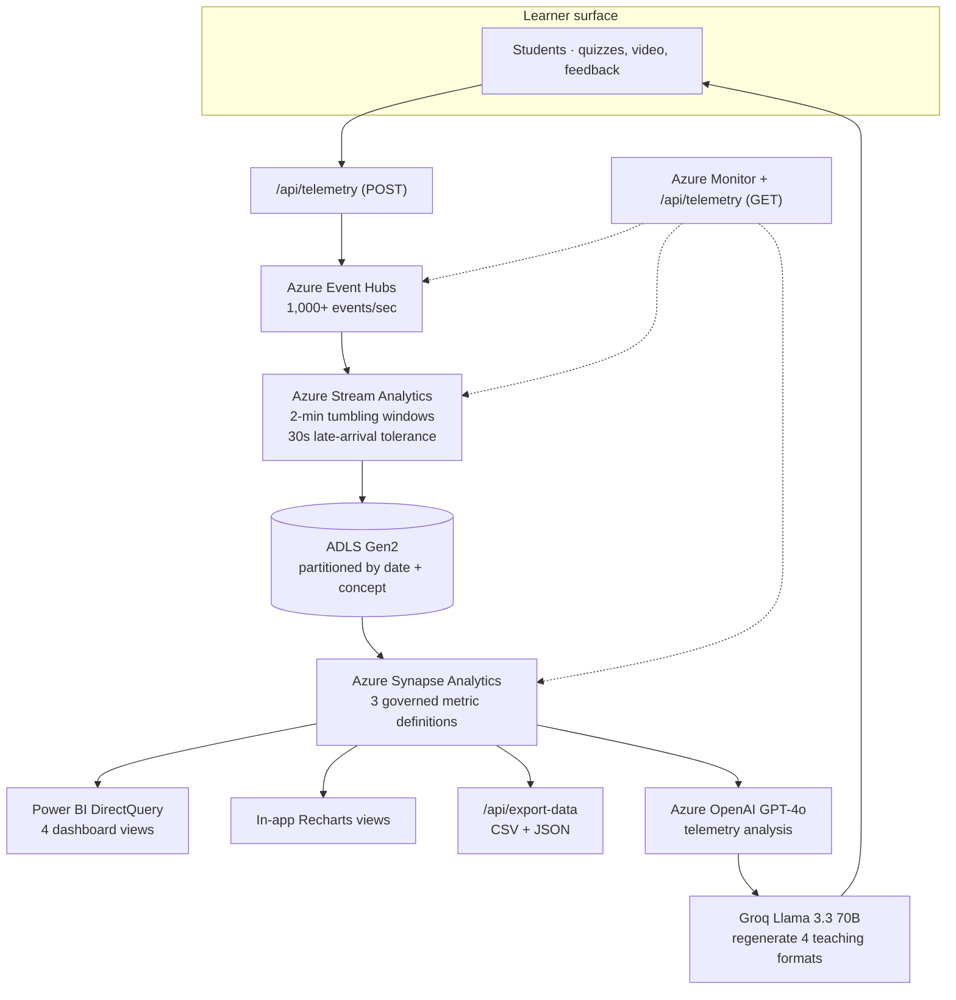
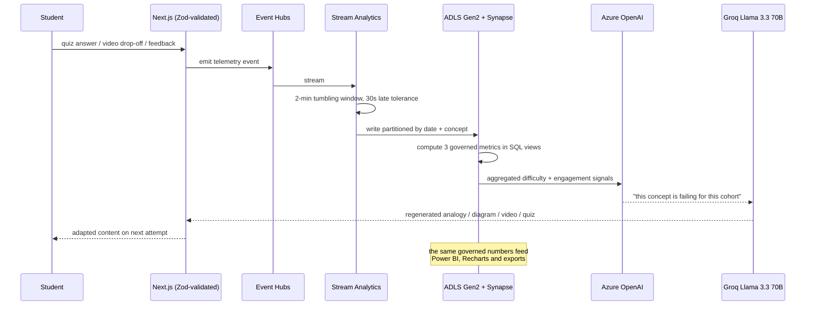

<div align="center">

# 🎓 EduMorph

### Self-Improving Learning Analytics Platform

> Every student who learns makes the next student's experience better — automatically.


<br/>


</div>

---

## Highlights

- Streamed quiz scores, video drop-offs and learner feedback at **1,000+ events per second** through **Azure Event Hubs** and **Stream Analytics** into **ADLS Gen2**, partitioned by date and concept for downstream engagement and difficulty analytics.
- Aggregated engagement and difficulty metrics in Azure Stream Analytics using **2-minute tumbling windows** with a **30-second late-arrival tolerance** before loading results into **Synapse**.
- Modeled concept difficulty, engagement and format effectiveness as **3 governed metric definitions** in Synapse SQL views over Data Lake Gen2, keeping the numbers consistent across Power BI DirectQuery dashboards, in-app Recharts views, and CSV and JSON exports.
- Built a closed-loop architecture across **5 Azure services** — Event Hubs, Stream Analytics, Data Lake Gen2, Synapse Analytics and Azure OpenAI — turning learner behavior into adaptive teaching strategy instead of a weekly static report.
- Routed **4 telemetry categories** through Stream Analytics into a partitioned, terabyte-scale learner telemetry store rather than dumping raw events into a lake.
- Connected Power BI to Synapse via **DirectQuery**, giving **4 dashboard views**: concept difficulty, format effectiveness, engagement trends and cohort comparisons — live, with no manual refresh cycle.
- Exposed `/api/export-data` with **2 export formats** (CSV and JSON), so Power BI Desktop and external BI tools consume the same governed datasets.
- Used **Azure OpenAI GPT-4o** to analyze aggregated telemetry and **Groq Llama 3.3 70B** to regenerate **4 teaching formats** — analogies, diagrams, explainer videos and quizzes — in sub-second flows.
- Built **6 Next.js route handlers** for generation, quiz generation, telemetry, analytics, student analytics and exports, with **Zod** validation on every AI input and output schema.
- Added Azure Monitor plus a custom `/api/telemetry` endpoint with **2 methods** — POST for ingestion, GET for health — because a data platform without health visibility cannot be debugged.
- Shipped reproducibly: Vercel Git integration auto-deploys on push to `main`, creates preview URLs per pull request, and **4 setup guides** stand the Azure, Synapse and Power BI stack up in **30 minutes**.

---

## Data platform architecture



## The self-improving loop



---

## Governed metrics

One definition, three consumption surfaces — Power BI, in-app Recharts, and exports — so no surface recalculates a number differently.

| Metric | Definition lives in | Consumed by |
|---|---|---|
| Concept difficulty | Synapse SQL view | Power BI · Recharts · CSV/JSON |
| Learner engagement | Synapse SQL view | Power BI · Recharts · CSV/JSON |
| Format effectiveness | Synapse SQL view | Power BI · Recharts · CSV/JSON |

## Tech stack

**Streaming & storage** Azure Event Hubs · Azure Stream Analytics · Azure Data Lake Storage Gen2
**Warehouse & BI** Azure Synapse Analytics · Synapse SQL views · Power BI DirectQuery
**AI** Azure OpenAI GPT-4o · Groq Llama 3.3 70B
**App** Next.js 14 · React · TypeScript · Tailwind CSS · Zustand · Recharts · Zod
**Ops** Azure Monitor · Vercel CI/CD with preview environments · pnpm workspaces · ESLint · TypeScript strict

## Quick start

```bash
git clone https://github.com/Brijesh03032001/eduMorph.git
cd eduMorph
pnpm install
cp .env.example .env.local    # EVENTHUB_CONNECTION, SYNAPSE_*, AZURE_OPENAI_*, GROQ_API_KEY
pnpm dev
```

See `docs/` for the 4 setup guides covering Event Hubs, Stream Analytics, Synapse and Power BI (about 30 minutes end to end).

---

**Built by [Brijesh Kumar](https://github.com/Brijesh03032001)** · [Portfolio](https://brijeshbuilds.com) · [LinkedIn](https://linkedin.com/in/brijeshkumar03)
